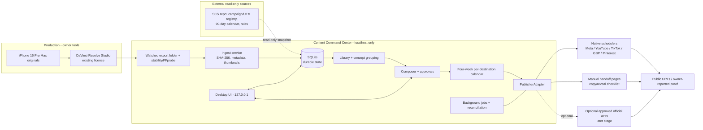

# Architecture — Content Command Center

**Status:** Stage 0 proposal. Every component below is **PROPOSED / ADR REQUIRED** and
unimplemented. Nothing here claims current functionality.

---

## 1. Architectural principles

1. **Local-first:** the core system runs on this Windows PC with no cloud dependency;
   loopback interface only (`127.0.0.1`).
2. **Originals are sacred:** ingest copies; sources are never mutated.
3. **Honest state:** durable SQLite rows are the single source of UI truth; every status
   has evidence rules.
4. **Separation of concerns:** ingest, library, composer, publishing adapters, and UI are
   distinct modules with explicit interfaces.
5. **Adapters over integrations:** publishing is behind a replacement-safe contract so
   native handoff, manual packages, and future approved APIs coexist.
6. **Idempotent, resumable jobs:** no blind retries on ambiguous outcomes.
7. **Windows-real:** path length, file locks, permissions, drive letters, Unicode, and
   drive-space limits are first-class.

## 2. System context



## 3. Process boundaries (proposed)

| Process | Responsibility | Trust notes |
|---|---|---|
| API/UI server (FastAPI) | HTTP API + static UI on `127.0.0.1` | No remote bind; no public exposure |
| Watcher/ingest worker | Folder monitoring, stability checks, FFprobe, hashing, thumbnails | Never publishes; writes only to library root + DB |
| Job runner | Durable local jobs, retries, reconciliation, reminders | Idempotency keys; no blind retry |
| Future publisher adapters | Native handoff packages, manual packages, approved APIs | Least privilege; per-destination isolation |

A single-process MVP option (one process for API + background tasks) is explicitly on
the table to reduce Windows deployment friction; the ADR must choose before Stage 1
implementation. See `docs/DECISION_LOG.md` ADR-005.

## 4. Proposed stack and Windows constraints

- Python 3.11+ **FastAPI** bound to `127.0.0.1` — PROPOSED. The audit found Python
  **3.14.7** installed; compatibility must be verified in Stage 1 rather than assumed.
- **SQLite** in `%CC_ROOT%\_app\db\content.sqlite` with WAL + explicit migrations.
- **watchdog** for non-recursive folder observation.
- **FFmpeg/ffprobe CLI** — PROPOSED; **not currently detected on PATH** on this
  machine. Stage 1 must resolve installation of a free build with owner approval, plus
  license review (FFmpeg is LGPL-2.1+ with GPL parts depending on build; see
  `docs/OPEN_SOURCE_EVALUATION.md`).
- React + Vite + TypeScript UI — PROPOSED.
- Existing Resolve Studio (19.0.0.69) — no scripting dependency required for MVP; a
  watched folder is the integration boundary.

Windows constraints to design for: MAX_PATH/path-length handling, file locking during
render, drive-letter changes, Unicode filenames, antivirus interference with rapid file
writes, and the absence of a guaranteed `D:` drive.

## 5. Data and storage strategy

- Durable metadata lives only in SQLite; the filesystem holds media and manifests.
- Library root is configurable per workspace; SCS first, Sparkling Standard later in a
  separate root with separate permissions.
- No hosting, buckets, or cloud storage in the baseline. If a future approved API needs
  a publicly fetchable media URL, that is a separate design review (limited HTTPS
  staging), never exposure of the whole archive.
- Backups: scheduled consistent SQLite backup + manifests/metadata export to existing
  storage. A true 3-2-1 strategy needs another independent device/location; if none
  exists it remains an **unresolved gap**, not an implied capability.

## 6. UI module map (proposed)

| Module | Purpose |
|---|---|
| Dashboard | Upcoming posts, unscheduled assets, failed publications, connection status, gaps |
| Library | Assets, concepts, filters/search, previews, metadata, relink |
| Composer | Master description → per-platform variants, validation, approval |
| Calendar | Month/week views, per-account coverage, reschedule, status visualization |
| Campaigns | Series/campaign groups, objectives, approved link snapshot status |
| Analytics (later) | Imported platform metrics + links to SCS reporting; never fabricates business outcomes |
| Accounts | Workspace connections, status honesty, permissions, health |
| Settings | Watched folders, storage roots, templates, notifications, security |
| Time & audit | Time per package, audit events, ingest/backup runs |

## 7. Publishing architecture

### 7.1 PublisherAdapter contract (replacement-safe)

```text
PublisherAdapter
  capabilities(account) -> { media_types, max_duration, caption_limit,
                             thumbnails, links, scheduling_window, verification }
  validate(draft, asset) -> [errors, warnings]
  prepare(draft) -> handoff_package | payload
  schedule(mode, when) -> job      # only when user selects that route
  reconcile(job) -> status
  cancel(job) -> status
```

Modes:

- `NATIVE_HANDOFF` — open the documented official destination page with the correct
  export/caption/link surfaced for human final action; record owner confirmation.
- `MANUAL` — produce the complete publication package + checklist + reminder.
- `API_PUBLIC` — only for separately approved, audited, zero-cost official APIs; must
  have idempotency, reconciliation, and verified-publication evidence rules.

No mode may share credentials, cookies, or sessions across workspaces; no mode may use
password login, scraping, or browser automation against platform terms.

### 7.2 Status model

Editorial approval and publication state are separate:

- Concept editorial: `IDEA → SCRIPTED → FILMED → EDITED → IMPORTED →
  READY_FOR_REVIEW → APPROVED → SCHEDULED → PUBLISHED` (concept-level, human).
- Per-destination publication: `DRAFT → PREPARED → APPROVED → EXPORTED →
  NATIVE_SCHEDULED | API_SCHEDULED | MANUAL_PENDING → SUBMITTING →
  PLATFORM_CONFIRMED | OWNER_REPORTED_MANUAL | FAILED | UNKNOWN | CANCELLED`.

Rules: `PLATFORM_CONFIRMED` requires verified public evidence; timeout → `UNKNOWN` with
reconciliation before retry; a parent concept is never fully published while any
selected destination is incomplete.

## 8. Publishing destination strategy (summary)

Full dated matrix in `docs/PLATFORM_CAPABILITIES.md`. Baseline:

- Native scheduling/handoff for Facebook, Instagram, YouTube, TikTok, Google Business
  Profile, Pinterest, Nextdoor (Share Plugin).
- Manual packages for X (API is pay-per-use as of 2026), Yelp, Rumble/Locals, and any
  destination without a verified zero-cost route.
- Optional API adapters only after Stage 5-style approval, with the free routes kept
  permanently available.

## 9. Security architecture baseline

- Loopback-only bind; no remote authentication surface initially.
- Secrets (future) via Windows Credential Manager/DPAPI; never in the DB in plaintext,
  logs, fixtures, or git.
- Least-privilege scopes per destination; per-workspace isolation.
- Audit events for approvals, handoffs, status changes, imports, backups, and any
  external send.
- Fail closed on missing/unknown configuration.

## 10. Decisions vs provisional

| Item | Classification |
|---|---|
| Local-first + loopback + SQLite + watched folder | Decision (this charter/directive) |
| PublisherAdapter contract shape | Decision (provisional; ADR before implementation) |
| FastAPI + React/Vite + watchdog + FFmpeg CLI | Proposal requiring ADR (see `docs/DECISION_LOG.md`) |
| Single-process MVP vs multi-process | Open — ADR required |
| Optional Tauri packaging | Provisional future |
| Postiz/TryPost/Mixpost reuse | Deferred to Stage 5 evaluation |
| Any Docker/self-hosted service | Deferred; resource and license review required |
