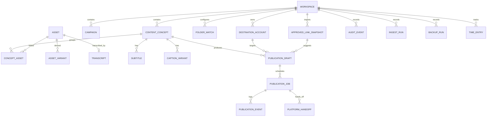

# Data Model — Content Command Center

**Status:** Stage 0 design (unimplemented). Table and field names are provisional and
will be fixed by the Stage 1/2 migrations. SQLite is the authoritative store; the
filesystem holds media.

---

## 1. Entity overview



Fire-and-forget mapping rule: every row that could trigger an external action carries an
`idempotency_key` (unique per intended action) and an evidence trail before retry.

## 2. Core tables (provisional fields)

### workspace
`id`, `name`, `slug`, `root_path`, `branding_json`, `is_active`, `created_at`,
`permissions_policy_json`. Isolation unit: separate root, permissions, campaigns,
accounts, and calendar. SCS is workspace 1; Sparkling Standard is a later separate row.

### destination_account
`id`, `workspace_id`, `platform`, `display_name`, `account_ref`, `connection_status`
(`not_configured|saved|verified|connected|connection_failed|adapter_not_implemented|unavailable`),
`capability_profile_json`, `last_checked_at`, `notes`. **Never stores plaintext tokens**;
future secret material lives in the OS credential store and is referenced by key name.

### campaign
`id`, `workspace_id`, `code` (e.g. `ac_repair`, `airflow`, `maintenance`,
`replacement`, `tab_commissioning`, `commercial_hvac`), `engine` (`residential` /
`commercial_tab` / `fundraiser`), `owning_path`, `primary_cta`, `status`, `notes`.

### approved_link_snapshot
`id`, `workspace_id`, `source_repo`, `source_commit_sha`, `generated_at`,
`imported_at`, `snapshot_json`, `freshness_state`, `verified_pending_count`. Imported
read-only from SCS `marketing-links.ts` outputs; pending links are retained but never
offered as approved.

### content_concept
`id` (stable, e.g. `SCS-2026-10-001`), `workspace_id`, `title`, `slug`, `campaign_id`,
`engine`, `audience`, `owning_page`, `primary_cta`, `status`
(`idea|scripted|filmed|edited|imported|ready_for_review|approved|scheduled|published|archived`),
`risk_flags_json`, `notes`, timestamps.

### concept_asset (join)
`concept_id`, `asset_id`, `role` (`master|short|still|thumbnail|project_ref|subtitle|other`),
`sort_order`.

### asset
`id`, `workspace_id`, `concept_id` (optional until grouped), `kind`
(`video|audio|image|subtitle|project|document`), `path`, `display_name`,
`file_size`, `sha256`, `mime`, `duration_ms`, `width`, `height`, `fps`, `rotation`,
`color_transfer`, `audio_streams_json`, `probe_json`, `thumbnail_path`, `source`
(`watched|manual|import`), `imported_at`, `archived_at`, `original_preserved` (always
true for ingest), `logical_version`.

### asset_variant
`id`, `asset_id`, `variant_type` (`master_16x9|short_9x16|square|thumbnail|caption_file|other`),
`label`, `path`, `sha256`, `notes`, `approved_at/null`.

### transcript / subtitle
`transcript`: `id`, `asset_id`, `engine` (Resolve or local tool), `language`,
`text_path`, `review_state`, `created_at`.
`subtitle`: `id`, `concept_id`, `asset_variant_id`, `path`, `format`, `language`,
`corrected` (bool), `reviewed_by`, `reviewed_at`.

### caption_variant
`id`, `concept_id`, `destination_account_id`, `body`, `title`, `hashtags_json`,
`link_id` (FK to snapshot link), `ai_assisted` (bool), `state`
(`draft|prepared|approved|rejected`), `approved_by`, `approved_at`, `validation_json`.

### project_reference
`id`, `concept_id`, `path`, `kind` (`resolve_project|notes|manifest|other`),
`relink_manifest_json`.

### publication_draft
`id`, `concept_id`, `destination_account_id`, `asset_variant_id`, `caption_variant_id`,
`mode` (`native_handoff|manual|api_public`), `scheduled_for_utc`, `timezone`,
`state` (see §4), `created_at`, `updated_at`.

### publication_job
`id`, `publication_draft_id`, `idempotency_key`, `attempt`, `next_attempt_at`,
`state`, `provider_request_id`, `provider_response_json_redacted`, `error_code`,
`error_message`, `created_at`, `updated_at`.

### platform_handoff
`id`, `publication_job_id`, `package_path`, `target_url`, `checklist_json`,
`owner_confirmed_at`, `evidence_json`.

### publication_event
`id`, `publication_job_id`, `event_type`, `event_at`, `detail_json`, `public_url`,
`evidence_source` (`api_verified|destination_ui|owner_reported|imported`).

### audit_event
`id`, `workspace_id`, `actor`, `action`, `entity_type`, `entity_id`, `at`,
`detail_json_redacted`.

### folder_watch / ingest_run
`folder_watch`: `id`, `workspace_id`, `path`, `recursive` (default false), `enabled`,
`stability_seconds`, `created_at`.
`ingest_run`: `id`, `folder_watch_id`, `source_path`, `state`, `started_at`,
`finished_at`, `bytes`, `sha256`, `error`, `resumed_from`.

### backup_run
`id`, `workspace_id`, `db_backup_path`, `manifest_path`, `started_at`, `finished_at`,
`state`, `notes`. Never contains unencrypted credentials.

### time_entry
`id`, `workspace_id`, `concept_id`, `phase`
(`plan|film|edit|ingest|review|schedule|handoff|publish|verify`), `minutes`,
`recorded_at`, `note`. Used for the labor-reduction objective, never to fake KPIs.

## 3. Evidence rules

- `asset.original_preserved` must be true for watched-folder imports.
- `publication_event` is append-only; corrections are new events.
- `PLATFORM_CONFIRMED` requires an event whose `evidence_source` is
  `api_verified` or `destination_ui` with a public URL or destination acceptance
  evidence. `owner_reported` alone maps to `OWNER_REPORTED_MANUAL`.
- Counts shown in the UI are computed from these tables; there is no separate counter
  store to drift.

## 4. Publication lifecycle

```text
DRAFT → PREPARED → APPROVED → EXPORTED
      → NATIVE_SCHEDULED  (handoff recorded; schedule lives on the platform)
      → API_SCHEDULED     (approved API only)
      → MANUAL_PENDING    (package ready; reminder set)
      → SUBMITTING        (API path; idempotency key active)
      → PLATFORM_CONFIRMED | OWNER_REPORTED_MANUAL | FAILED | UNKNOWN | CANCELLED
```

- `UNKNOWN` (e.g. provider timeout) requires reconciliation before any retry.
- Cancelling a `NATIVE_SCHEDULED` item requires the owner to cancel at the destination;
  the app tracks that fact rather than pretending it can always cancel remotely.

## 5. Migrations and backups

- Explicit, ordered SQL migrations; no automatic destructive migration.
- Consistent SQLite backup before schema change; backup + manifests exported per
  `backup_run`; restore drill in Stage 4.
- No runtime database or private media in git; `.gitignore` enforces this.

## 6. Future credential storage

Tokens are never stored in SQLite in plaintext. Proposed: DPAPI-protected blob or
Windows Credential Manager, referenced by opaque key; key names only in the DB.
Backups must exclude credential material or store it encrypted with owner-held keys.
